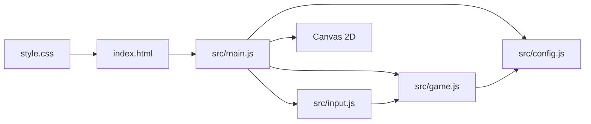
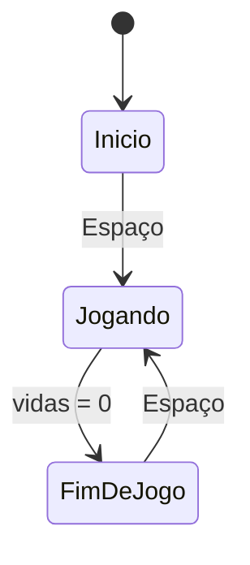

# Design: Chuva de Bugs

## Visão geral
O jogo será uma página HTML com uma área Canvas 2D fixa e centralizada. O estado da partida ficará separado da entrada do teclado e da renderização, com `main.js` coordenando o loop. O jogador verá telas de início, jogo e fim, enquanto o recorde será lido e salvo no armazenamento do navegador. A implementação usará apenas HTML, CSS e JavaScript com módulos ES, sem dependências externas.

## Decisões técnicas
| Decisão | Escolha | Por quê |
|---|---|---|
| Área de jogo | Canvas 2D de tamanho fixo | Combina com a ideia visual e mantém colisões e desenho simples. |
| Representação visual | Emojis desenhados com `fillText` | Atende ao tema sem imagens, áudio ou bibliotecas externas. |
| Loop | `requestAnimationFrame` com delta time em segundos | Mantém o movimento consistente entre quadros. |
| Entrada | Eventos `keydown` e `keyup` para setas e A/D | Atende aos dois controles de teclado previstos. |
| Persistência | `localStorage` para o recorde | Mantém o recorde após fechar e abrir a página. |
| Dificuldade | Velocidade e intervalo de criação calculados pelo tempo da partida | Aumenta o desafio sem alterar pontos ou vidas. |

## Arquitetura


## Estrutura de arquivos
```text
index.html          Página e elemento Canvas do jogo.
style.css           Fundo escuro, centralização e dimensões visuais da página.
src/config.js       Objeto CONFIG com todas as constantes ajustáveis.
src/input.js        Estado das teclas e registro dos eventos do teclado.
src/game.js         Estado da partida, atualização dos itens, colisões e recorde.
src/main.js         Inicialização, loop, desenho das telas e desenho do Canvas.
```

## Componentes
### `index.html`: página do jogo
- **Responsabilidade:** Declarar a página, o Canvas e carregar `src/main.js` como módulo.
- **Estado:** Nenhum estado de jogo; mantém apenas a estrutura visual.
- **Funções principais:** Nenhuma.
- **Atende:** 1.1, 4.3, 6.1, 6.4.

### `style.css`: apresentação da página
- **Responsabilidade:** Centralizar a área fixa do jogo e aplicar o fundo escuro.
- **Estado:** Nenhum estado de jogo.
- **Funções principais:** Nenhuma.
- **Atende:** 1.1.

### `src/config.js`: configuração central
- **Responsabilidade:** Exportar o único objeto `CONFIG` com dimensões, velocidades, probabilidades, emojis, cores e textos ajustáveis.
- **Estado:** Nenhum estado mutável da partida.
- **Funções principais:** Exportar `CONFIG`: fornecer valores usados pelos outros módulos.
- **Atende:** 2.3, 3.1, 3.2, 4.1, 4.2, 5.1, 5.2.

### `src/input.js`: controle do teclado
- **Responsabilidade:** Manter as teclas esquerda e direita inicializadas como `false` e atualizá-las nos eventos do teclado.
- **Estado:** `left`, `right` e solicitação de início/reinício por Espaço.
- **Funções principais:** `setupInput()`: registrar os eventos; `getInput()`: devolver o estado atual do controle.
- **Atende:** 1.2, 1.3, 2.1, 2.2.

### `src/game.js`: regras da partida
- **Responsabilidade:** Criar e reiniciar partidas, mover o dev, criar e mover itens, detectar colisões, atualizar pontos e vidas, aumentar a dificuldade e salvar o recorde.
- **Estado:** Tela atual, posição do dev, pontos, vidas, tempo da partida, intervalo desde a última criação, lista de itens e recorde.
- **Funções principais:** `createGame()`: inicializar o estado; `startGame()`: zerar pontos e restaurar 3 vidas; `updateGame(delta, input)`: aplicar as regras de um quadro; `getView()`: fornecer estado para desenho; `loadHighScore()`: ler o recorde; `saveHighScore(score)`: persistir novo recorde.
- **Atende:** 1.2, 1.3, 2.1, 2.2, 2.3, 3.1, 3.2, 3.3, 4.1, 4.2, 5.1, 5.2, 5.3, 6.1, 6.2, 6.3.

### `src/main.js`: coordenação e renderização
- **Responsabilidade:** Obter o Canvas, iniciar o jogo, executar o loop com delta time, desenhar telas, HUD, dev e itens, e encaminhar Espaço para iniciar ou reiniciar.
- **Estado:** Referência do Canvas e instante do quadro anterior; o estado da partida pertence a `game.js`.
- **Funções principais:** `gameLoop(timestamp)`: calcular delta e coordenar atualização e desenho; `render(view)`: desenhar a tela atual; `drawPlayer()` e `drawItems()`: desenhar os elementos da partida.
- **Atende:** 1.1, 1.2, 1.3, 4.3, 6.1, 6.4.

## Configuração central (`CONFIG` em `src/config.js`)
| Constante | Valor inicial | Para que serve | Atende |
|---|---:|---|---|
| `canvasWidth` | 640 | Largura da área fixa do jogo. | 2.3, 3.1 |
| `canvasHeight` | 480 | Altura da área fixa do jogo. | 2.3, 3.2, 3.3 |
| `initialLives` | 3 | Vidas no começo de cada partida. | 1.2, 1.3 |
| `playerSpeed` | 280 | Velocidade horizontal do dev. | 2.1, 2.2 |
| `itemBaseSpeed` | 120 | Velocidade inicial de queda. | 3.2 |
| `itemSpeedIncrease` | 8 | Aumento da velocidade por unidade de tempo. | 5.1 |
| `initialSpawnInterval` | 0.9 | Intervalo inicial entre criações. | 3.1, 5.2 |
| `spawnIntervalDecrease` | 0.02 | Redução do intervalo conforme o tempo passa. | 5.2 |
| `minimumSpawnInterval` | 0.25 | Limite inferior do intervalo de criação. | 5.2 |
| `coffeeProbability` | 0.6 | Probabilidade de criar café em vez de bug. | 3.1 |
| `collisionDistance` | 30 | Distância usada para considerar toque entre elementos. | 4.1, 4.2 |
| `highScoreKey` | `chuvaDeBugsHighScore` | Chave do recorde no armazenamento do navegador. | 6.2, 6.3 |
| `playerEmoji` | `🧑‍💻` | Emoji do dev. | 1.1 |
| `coffeeEmoji` | `☕` | Emoji do café. | 3.1, 4.1 |
| `bugEmoji` | `🐛` | Emoji do bug. | 3.1, 4.2 |

## Fluxo


Em cada quadro do loop principal:
1. `main.js` calcula o delta time em segundos e lê o controle atual.
2. `game.js` move o dev, limitando sua posição à largura do Canvas.
3. `game.js` atualiza o tempo, calcula a dificuldade e cria itens quando o intervalo termina.
4. `game.js` move os itens, remove os que chegam ao chão e resolve colisões com o dev.
5. Se uma colisão reduzir as vidas a 0, `game.js` encerra a partida e atualiza o recorde quando necessário.
6. `main.js` desenha a tela atual, o HUD, o dev e os itens.

## Propriedades de corretude
- Para qualquer quadro de uma partida, a posição horizontal do dev fica entre os limites da área do jogo. (Valida: 2.3)
- Para qualquer item que toque o dev, o item é removido e exatamente uma consequência é aplicada conforme seu tipo. (Valida: 4.1, 4.2)
- Para qualquer item que alcance o chão sem tocar o dev, o item é removido sem alterar pontos ou vidas. (Valida: 3.3)
- Para qualquer quadro da mesma partida, a pontuação e as vidas não são reiniciadas pelo aumento de dificuldade. (Valida: 5.3)
- Para qualquer encerramento com vidas iguais a 0, a partida não aceita atualizações de jogo e exibe a pontuação final e o recorde. (Valida: 6.1)
- Para qualquer pontuação final maior que o recorde carregado, o valor salvo passa a ser a pontuação final. (Valida: 6.2, 6.3)

## Casos limite
- Se o jogador mantiver esquerda e direita pressionadas ao mesmo tempo, os deslocamentos se anulam e o dev permanece parado.
- Se o dev estiver encostado em uma borda, novos comandos para fora da área não alteram sua posição.
- Se vários itens forem resolvidos no mesmo quadro, cada um será processado uma vez.
- Se o recorde salvo não existir ou não for um número válido, o jogo usará 0.
- Se a aba ficar suspensa e o delta time for muito grande, o quadro limitará o delta ao valor configurado para evitar saltos de posição.